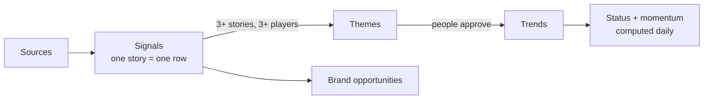

# trend-signal-tracker

Rules for turning scattered market signals into themes and trends, written as small deterministic functions with tests.

It comes from a trend tracker I run in Notion for a premium fashion brand. An AI agent reads publications, platform trend tools, search data, competitor sites and consumer discussion every weekday, logs what changed, and works out which patterns are strengthening. This repository holds the method and the parts that must be exact: signal strength, duplicate detection, theme checks, trend status and momentum.

No client data is included. The sample dataset is made up.



## The rules

| Rule | Summary | Code |
|---|---|---|
| Strength | 1–5 stars for how well one story is corroborated. Syndicated copies of one press release count once. Quantitative primary data adds stars. | `strength.py` |
| Duplicates | Same URL or story key → update. Similar story from the same player within days → flag for a person. Otherwise → create. | `dedupe.py` |
| Themes | 3+ separate stories from 3+ different players. | `themes.py` |
| Status | Watching → Strengthening at 5+ stories, 4+ players, 2+ sectors or audiences, 7+ day span. Human-set Confirmed/Fading is never overwritten. | `status.py` |
| Momentum | Rising at 3+ newly observed stories in the trailing 7 days. Falling is human-only. | `status.py` |

The full method, including evidence rules and what the agent may and may not do on its own, is in [docs/METHODOLOGY.md](docs/METHODOLOGY.md).

## Why code and not just a prompt

The agent is good at reading sources and explaining why something matters. It is not reliable at counting distinct players across a dozen rows or applying the same 7-day window every morning. Moving those rules into tested functions makes each run reproducible, and every status change comes with the counts behind it. Thresholds sit in one `Thresholds` object, so changing a rule is a reviewed code change, not a prompt edit.

## Quick start

```bash
pip install -e ".[dev]"
pytest
python examples/run_demo.py
```

Demo output on the sample dataset:

```
SIGNAL STRENGTH
  S1   ★☆☆☆☆  1 indep.  One traceable source.
  S3   ★★☆☆☆  2 indep.  Two independent sources.
  S6   ★★★★★  3 indep.  Quantitative primary data covering 2 markets and a period of 56+ days.

INCOMING: DUPLICATE TRIAGE
  N1   update  S4: same URL
  N2   flag    S1: shared players ['atelier nord'], dates within 3d, title similarity 0.87
  N3   create  no match

TRENDS (as of 2026-11-25)
  Quiet utility outerwear
    status:   watching -> strengthening
    momentum: below_threshold -> rising  3 new stories since 2026-11-18.
  Investment-piece buying
    status:   confirmed (no change)
    calc:     ... Set by a person and kept; rules alone would give watching.
```

(Shortened. Run it to see every row.)

## Using the functions

```python
from datetime import date
from trend_tracker import compute_status, compute_momentum, score_strength, triage, load_dataset, signals_for_trend

data = load_dataset("examples/sample_dataset.json")
trend = data.trends[0]
linked = signals_for_trend(trend.id, data.themes, data.signals)

status = compute_status(trend.status, linked)
print(status.status, status.failed_tests)
print(status.calculation(date(2026, 11, 25)))  # one line for the trend's calculation field
```

## Layout

```
src/trend_tracker/   models, config (thresholds), strength, dedupe, themes, status, serialization
tests/               unit tests for every rule, plus a test that pins the sample dataset results
examples/            made-up dataset and a demo script
docs/METHODOLOGY.md  the full method
```

## Roadmap

- [ ] Notion template as code: schema for the five linked databases and a script that builds them through the Notion API
- [ ] Eval set: labelled example signals and a harness that scores an agent run against them
- [ ] Multilingual field labels (the live tracker isn't in English, and its sources come in several languages)

## About

Built by Solomiya Khrushch at PinAtelier, a Pinterest-based demand intelligence practice. MIT licensed.
