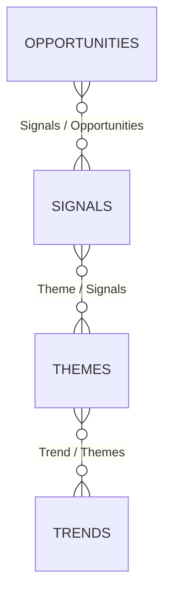

# Notion template: field reference

<!-- Generated by `python -m trend_tracker.notion glossary`. Do not edit by hand. -->

Select options are examples. Edit markets, audiences, product categories and languages to fit your brand before building. Options are written as [name, color].

## Signals

One story = one row. Observation, interpretation and evidence for a single change.

| Property | Type | Notes |
|---|---|---|
| Signal | title | Short headline of the change. |
| Event date | date | When the change happened. |
| First seen | date | Run date when the signal was first logged. Drives momentum. |
| Source | rich text | Primary source name. |
| Link | url | Primary URL. |
| Also seen in | rich text | Other independent sources for the same story. |
| What happened | rich text | Observation: what the source shows. No interpretation. |
| Why it matters | rich text | Interpretation for the brand. |
| Original wording | rich text | Short key phrases or search terms in the source language. |
| English | rich text | English rendering of the original wording. |
| Source language | select | Options: EN, FR, DE, ES, IT, PL, Other. |
| Market | multi select | Geography of the evidence, not of the brand. Options: France, Germany, United Kingdom, Europe, Global. |
| Signal type | select | Options: Launch / collection, Search demand, Platform data, Editorial, Consumer discussion, Research / report, Retail / business, Culture / event. |
| Driver | multi select | STEEP driver. Leave empty when unknown. Options: Social, Technological, Economic, Environmental, Political. |
| Sector | multi select | Options: Beauty, Fashion, Outfits, Styling. |
| Audience | multi select | Only when the evidence identifies the audience. Options: Premium 25+, Premium under 25, Diaspora shoppers. |
| Product category | multi select | Options: Coats, Trench coats, Short coats, Blazers, Vests, Jeans, Other. |
| Platforms | multi select | Where the story is confirmed. One platform = local signal; three or more = stronger. Options: Pinterest, Google, TikTok, Instagram, YouTube, Media, Forums / Reddit, Reviews, Brand sites, Other. |
| Strength | select | Corroboration of this story (see METHODOLOGY.md §3). Computed by score_strength(). Options: ★, ★★, ★★★, ★★★★, ★★★★★. |
| Confidence | select | Kept separate from coverage volume. Options: High, Medium, Low. |
| Change % | number | Rate of change from primary data. Period and baseline go in Metric / baseline. |
| Metric / baseline | rich text | Metric, geography, period, comparison and method. |
| Players | rich text | Brands, people or institutions involved. |
| Limitations | rich text | Seasonality, small sample, paid promotion and similar. |
| Red flags | multi select | Risks to the signal's reliability. Options: Single influencer, Paid promotion, Syndication / one press release, Seasonality, Small sample, Platform dependence, Cultural sensitivity. |
| Sentiment | select | Only for reviews and consumer discussion. Options: Positive, Negative, Mixed, Neutral. |
| Story key | rich text | Stable key for duplicate detection. One story = one key. |
| Evidence notes | rich text | Dated follow-ups to this story. |
| Review | select | Approved by default; Draft only for rows a run flags as ambiguous. Options: Draft, Approved, Rejected. |
| Theme | relation | Empty = unsorted. |
| Opportunities | relation |  |

Views: **All signals** (table, newest First seen first); **Unsorted** (table, Theme is empty, newest First seen first); **By sector** (board, grouped by Sector); **Needs review** (table, Review = Draft); **Approved** (table, Review = Approved, newest Event date first).

## Themes

A pattern shared by 3+ separate signals from 3+ different players. Each theme belongs to one trend.

| Property | Type | Notes |
|---|---|---|
| Theme | title |  |
| Pattern | rich text | What the signals have in common. |
| First seen | date |  |
| Sector | multi select | Options: Beauty, Fashion, Outfits, Styling. |
| Market | multi select | Options: France, Germany, United Kingdom, Europe, Global. |
| Stage | select | Lifecycle of the theme. Options: Emerging, Growing, Peak, Saturating, Declining. |
| Stage rationale | rich text | Weeks since first seen, platforms, pace, players, assessment date. |
| Fad or shift | select | Options: Likely fad, Likely lasting shift, Unknown. |
| Expected duration | select | Options: Under 1 season, 1–2 seasons, 2+ seasons. |
| Action window | select | When the brand should act. Options: Too early – monitor, Act now, Needs own angle, Skip. |
| Review | select | Options: Draft, Approved, Rejected. |
| Signals | relation |  |
| Trend | relation | Parent trend. Empty = needs review. |
| Signal count | rollup |  |

Views: **Themes by trend** (table, grouped by Trend).

## Trends

Cross-sector shifts in what people want or do. Created by people only; the agent may propose.

| Property | Type | Notes |
|---|---|---|
| Trend | title |  |
| Status | select | Computed by compute_status(). Confirmed and Fading are set by people only. Options: Watching, Strengthening, Confirmed, Fading. |
| Momentum | select | Rising = 3+ new stories in 7 days. Falling is set by people only. Options: Rising, Below rising threshold, Falling. |
| Hypothesis | rich text | What may happen next and how to test it. |
| Content angle | rich text |  |
| What would disprove it | rich text | Contradicting evidence and what would disprove the hypothesis. |
| First seen | date |  |
| Status calculation | rich text | Counts behind the current status and the date they were calculated. |
| Review | select | Options: Draft, Approved, Rejected. |
| Themes | relation |  |
| Signal count | rollup | Unique signals across the trend's themes. |
| Signals | rollup |  |

Views: **Trends** (table, sorted by Signal count descending); **Status board** (board, grouped by Status).

## Sources

Source register: access, research status and per-source checkpoints for each run.

| Property | Type | Notes |
|---|---|---|
| Source | title |  |
| Category | select | Options: Fashion publications, Pinterest Trends, Google Trends, TikTok Creative Center, Consumer discussion, Reviews, Keyword Planner, Search Console, Competitors / retail, Own catalogue & analytics, Platforms / research. |
| Link | url |  |
| Market | multi select | Options: France, Germany, United Kingdom, Europe, Global. |
| Language | multi select | Options: EN, FR, DE, ES, IT, PL, Other. |
| Access | select | Options: Confirmed, Needs checking, Unavailable, Paywalled, Sign-in required. |
| Research | select | Options: Done, Pending. |
| Origin | select | Whether the source was defined upfront or proposed by a run. Options: Predefined, New proposal. |
| Enabled | checkbox | Scanned in the daily run. |
| Checkpoint | rich text | Last processed record or date for this source. |
| Last successful check | date |  |
| Notes | rich text |  |

Views: **By category** (table, grouped by Category).

## Opportunities

Tests the brand can run based on signals. Forecasts are hypotheses.

| Property | Type | Notes |
|---|---|---|
| Opportunity | title |  |
| Market | multi select | Options: France, Germany, United Kingdom. |
| Audience | multi select | Options: Premium 25+, Premium under 25, Diaspora shoppers. |
| Need / search question | rich text | The need or search question, in original phrases. |
| Product attributes | rich text |  |
| Product | url | Verified current product URL. |
| Commercial implication | rich text |  |
| Test | select | Options: Pinterest content, SEO / search, Styling, Merchandising, Landing page, Customer research. |
| Horizon | select | Options: Now, 1–3 months, 3–6 months. |
| Confidence | select | Options: High, Medium, Low. |
| Assumptions | rich text |  |
| Risks | rich text | What could break the hypothesis: season, routing, availability, cannibalisation. |
| Validation metric | rich text |  |
| Baseline | rich text | Current value of the validation metric, period and source. |
| Success threshold | rich text | Defined before the test starts. |
| Test start | date |  |
| Review date | date |  |
| Impact | number | 1–5: potential commercial effect. |
| Brand fit | number | 1–5: fit with assortment and positioning. |
| Ease of test | number | 1–5: how fast and cheap the test is. |
| Timeliness | number | 1–5: timing given theme stage and season. |
| Status | select | Options: Idea, In progress, Tested, Parked. |
| Result | rich text |  |
| Decision | select | Options: Scale, Iterate, Stop, Not enough data. |
| Review | select | Options: Draft, Approved, Rejected. |
| Signals | relation |  |
| Priority | formula | Sum of the four 1–5 scores, max 20. 0 = not scored. |

Views: **By horizon** (board, grouped by Horizon); **By priority** (table, sorted by Priority descending).
